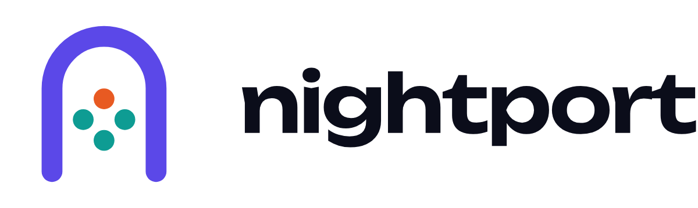
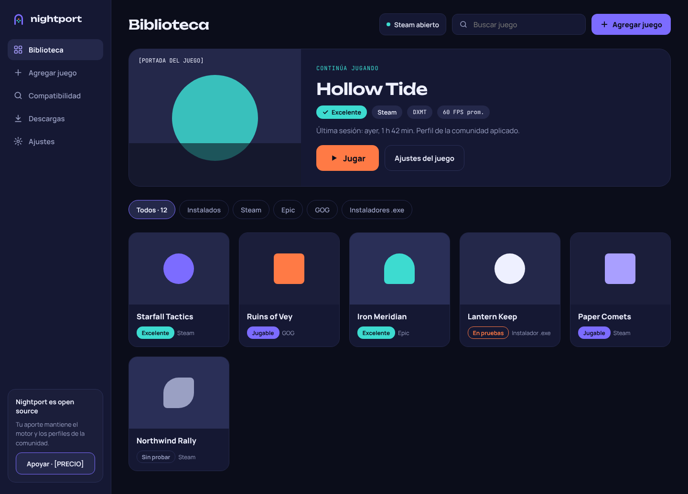

<p align="center">
  <picture>
    <source media="(prefers-color-scheme: dark)" srcset="brand/logo/png/nightport-lockup-dark-bg.png">
    
  </picture>
</p>

<p align="center"><b>Tus juegos de Windows, en casa en tu Mac.</b></p>

<p align="center">
  <a href="README.md">English</a> ·
  <a href="LICENSE">GPL-3.0</a> ·
  <a href="docs/MOTOR.md">Cómo se construye el motor</a> ·
  <a href="docs/JUEGOS.md">Compatibilidad</a>
</p>

---

Nightport es un lanzador open source que corre juegos de Windows (sobre todo de Steam) en Macs con
Apple Silicon. Está construido sobre Wine y traductores gráficos abiertos, y su idea central es
simple: **cada juego tiene un perfil curado** con el traductor y los ajustes que mejor le funcionan,
elegidos **midiendo** FPS y estabilidad de frametime en lugar de adivinar.

> **Proyecto personal.** Desarrollo Nightport en mi tiempo libre, principalmente para jugar mi propia
> biblioteca. Puedes usarlo, hacer fork y mandar mejoras, pero no hay soporte garantizado. Respalda
> tus partidas. Si te sirve y quieres apoyar, ve a [Apoyo](#apoyo).

<p align="center">
  
</p>

## Qué hace

- **Traductor gráfico por juego**: D3DMetal (Apple), DXMT, DXVK o wined3d, elegido por perfil, con
  alternativas para compararlas entre sí.
- **Integración con la biblioteca de Steam**: los juegos instalados aparecen solos y los perfiles
  curados los mejoran. Los que no están descargados abren el diálogo de instalación de Steam.
- **"¿Corre en tu Mac?"**: compara los requisitos de Windows publicados del juego con la GPU, la
  memoria unificada y el disco de tu Mac, considerando el costo de cada traductor.
- **Actividad**: graba tus sesiones (CPU, GPU, memoria, temperatura y FPS cuando se puede) con
  sugerencias. Nada sale de tu Mac.
- **CLI `gmac`** para todo lo que hace la app, con simulaciones (`--dry-run`) que muestran exactamente
  cómo se lanzaría un juego.

## Cómo funciona

```
Juego de Windows (.exe)
 └─ Wine 11 (compilado de las fuentes libres de CrossOver 26.3 de CodeWeavers + parches de Nightport)
     └─ traductor gráfico, elegido por juego:
          D3DMetal (Apple GPTK, lo aporta el usuario)   DX11/DX12 → Metal
          DXMT                                          DX10/DX11 → Metal
          DXVK + MoltenVK                               DX9–11 → Vulkan → Metal
          wined3d                                       DX1–11 → OpenGL
 └─ Rosetta 2 (el motor es x86_64)
```

| Pieza | Qué es |
|---|---|
| `Sources/GMCore` | Biblioteca Swift: motores, bottles (prefijos de Wine), perfiles, lanzador, Steam, diagnóstico |
| `Sources/GamingMacApp` | App SwiftUI (Nightport.app) |
| `Sources/gmac` | Herramienta de línea de comandos |
| `patches/wine` | Parches de Wine (ver abajo) |
| `profiles/` | Un perfil JSON por juego + `_defaults.json` ([formato](docs/PROFILES.md)) |
| `scripts/` | Descargar dependencias, compilar y empaquetar el motor, compilar la app |
| `tools/gmtest` | Programas de prueba DX11/DX12/pantalla/red |
| `brand/` | Logo, ícono, colores, fuentes y mockups |

### Lo más interesante técnicamente

- **Traductor por juego sin código propietario.** CrossOver elige D3DMetal o DXMT con un componente
  cerrado. Nightport agrega a Wine la ruta de búsqueda `WINEDLLPATH_PRIORITY`
  (`patches/wine/0001`) para que cada juego cargue un traductor distinto.
- **Un bug de ABI de clang que congelaba Steam.** Apple clang asume que los argumentos `BOOLEAN` (1
  byte) llegan extendidos a 32 bits; el código de Windows solo escribe el byte bajo. Steam pasaba
  `restart=FALSE` a `NtQueryDirectoryObject` con basura arriba, Wine lo leía como `TRUE` y entraba en
  un ciclo infinito (6 millones de llamadas en 25 s). Corregido en 36 syscalls (`patches/wine/0002`).
- **Argumentos por ejecutable** (`GMAC_APPEND_ARGS`, `patches/wine/0003`) para darle a la UI de Steam
  (Chromium) las banderas que necesita.
- **Toolchain reproducible sin Homebrew**: dependencias x86_64 de conda-forge con micromamba, DLLs PE
  con llvm-mingw, sin `sudo`.

## Requisitos

- Mac con Apple Silicon y Rosetta 2.
- macOS 13 o posterior para la app; macOS 15 o posterior para usar D3DMetal de Apple.
- Xcode Command Line Tools (Swift 5.9+) para compilar.
- Unos 10 GB libres para la toolchain y la compilación, más el espacio de tus juegos.

## Compilar desde el código

Todavía no hay descargas listas. Para compilar todo:

```bash
git clone https://github.com/Portisem/nightport.git
cd nightport
scripts/fetch-deps.sh            # toolchain + fuentes (unos GB, sin sudo)
scripts/build-engine.sh all      # compila Wine (30–60 min la primera vez)
scripts/assemble-engine.sh       # agrega DXMT, bibliotecas, Wine Mono/Gecko
scripts/build-app.sh             # instala ~/Applications/Nightport.app
```

Opcional, para juegos DX12: descarga el **Game Porting Toolkit** de Apple desde
[developer.apple.com](https://developer.apple.com/games/) (cuenta de Apple gratuita), monta el DMG y
corre `scripts/import-gptk.sh`. Nightport nunca incluye software de Apple.

Después crea un bottle e instala Steam:

```bash
swift build
.build/debug/gmac doctor                    # revisa el sistema
.build/debug/gmac bottle create Steam
.build/debug/gmac steam install Steam
.build/debug/gmac steam start Steam         # inicia sesión en Steam
.build/debug/gmac run halo-mcc --dry-run    # muestra exactamente cómo se lanzaría
.build/debug/gmac run halo-mcc --hud        # lanza con el HUD de rendimiento de Metal
```

Más: [docs/MOTOR.md](docs/MOTOR.md) (motor y hallazgos), [docs/PROBAR.md](docs/PROBAR.md) (cómo
probar y medir un juego), [docs/FASE0.md](docs/FASE0.md) (estrategia).

## Compatibilidad

Es una etapa temprana: hay pocos juegos con perfil y muchos pendientes. Ver
[docs/JUEGOS.md](docs/JUEGOS.md).

**Lo que no puede funcionar:** modos online protegidos por anti-cheat de kernel o solo para Windows
(Easy Anti-Cheat sin soporte de Wine, BattlEye, Vanguard). Los juegos con versión nativa de Mac
suelen correr mejor nativos.

## Contribuir

Los reportes de bugs, de juegos y los perfiles son lo más valioso. Usa los formularios de issues
(solicitud de juego, reporte de compatibilidad, bug) y lee [CONTRIBUTING.md](CONTRIBUTING.md). Las
solicitudes relacionadas con piratería se cierran.

## Apoyo

Nightport es gratis y lo seguirá siendo. Si te ahorra tiempo y quieres apoyarlo, las donaciones
voluntarias ayudan a cubrir costos como la membresía de desarrollador de Apple (necesaria para
firmar la app y que macOS la abra sin advertencias). Los enlaces aparecerán en el botón **Sponsor**
del repositorio cuando estén listos.

## Licencia

- Código: [GPL-3.0-or-later](LICENSE).
- Perfiles de juegos: [CC BY-SA 4.0](profiles/LICENSE).
- Nombre y logo de Nightport: ver [TRADEMARKS.md](TRADEMARKS.md).
- Componentes de terceros: [THIRD_PARTY_NOTICES.md](THIRD_PARTY_NOTICES.md).

Nightport no está afiliado a Apple, Microsoft, Valve ni CodeWeavers. Su motor se compila con las
fuentes libres de Wine que publica CodeWeavers; gracias a ellos y a los proyectos Wine, DXMT, DXVK y
MoltenVK.
