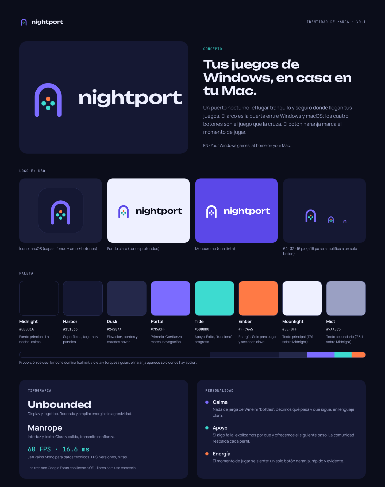

# Nightport · Guía de marca v0.1

> Tus juegos de Windows, en casa en tu Mac.
> *Your Windows games, at home on your Mac.*

Nightport es un puerto nocturno: el lugar tranquilo y seguro donde llegan tus juegos. El arco es la
puerta entre Windows y macOS; los cuatro botones son el juego que la cruza. El botón naranja marca
el momento de jugar.

## Contenido de esta carpeta

| Carpeta | Qué hay | Para qué |
|---|---|---|
| `logo/` | SVG del símbolo, logotipo y lockups (texto ya trazado, no necesita la fuente) | Fuente maestra del logo |
| `logo/png/` | Exportaciones PNG transparentes | README, redes, presentaciones |
| `icon/` | Ícono de app 1024 (SVG/PNG), `AppIcon.iconset` completo, capas para Icon Composer | `.icns` de la app |
| `fonts/` | Unbounded, Manrope, JetBrains Mono en TTF + licencias OFL | App y web |
| `tokens/` | `tokens.json` (fuente de verdad), `nightport.css` | Web y cualquier otra plataforma |
| `swift/` | `NightportTheme.swift` (tokens, botones, badge, logo en vector), `make-icon.swift` | Integración SwiftUI |
| `mockups/` | HTML estático + PNG de las pantallas | Referencia visual para implementar |
| `HANDOFF.md` | Instrucciones para Claude Code | Integración paso a paso |

## Logo

| Archivo | Úsalo en |
|---|---|
| `nightport-lockup-dark-bg.svg` | Fondos oscuros (principal) |
| `nightport-lockup-light-bg.svg` | Fondos claros (usa tonos profundos) |
| `nightport-lockup-mono-white.svg` | Una sola tinta sobre color o foto |
| `nightport-stacked-*.svg` | Espacios cuadrados (splash, perfil social) |
| `nightport-mark*.svg` | Solo el símbolo |
| `nightport-mark-small.svg` | Menos de 24 px: arco grueso y un solo botón |

**Reglas**
- Espacio libre alrededor: como mínimo el ancho del arco (la distancia entre sus dos patas).
- Tamaño mínimo del lockup horizontal: 96 px de ancho. Por debajo, solo el símbolo.
- El logotipo siempre en minúsculas: `nightport`. En texto corrido se escribe **Nightport**.
- No cambiar colores fuera de las variantes, no rotar, no añadir sombras ni degradados, no separar los botones del arco.

## Color

| Nombre | Hex | Rol |
|---|---|---|
| Midnight | `#0B0D1A` | Fondo principal |
| Harbor | `#151833` | Superficies, barra lateral, tarjetas |
| Harbor Hi | `#1B1E3A` | Inputs, filas activas |
| Dusk | `#24284A` | Elevación, chips, hover |
| Line | `#2A2F57` | Bordes |
| Portal | `#7C6CFF` | Primario: confianza, selección |
| Portal Soft | `#A99FFF` | Enlaces e íconos activos |
| Tide | `#3DDBD0` | Apoyo: funciona, progreso |
| Ember | `#FF7A45` | Energía: **solo** Jugar y acciones clave |
| Moonlight | `#EEF0FF` | Texto principal |
| Mist | `#9AA0C3` | Texto secundario |

Variantes para fondos claros: Portal Deep `#5B48E8`, Tide Deep `#0E9C93`, Ember Deep `#E85A22`.

**Proporción:** la noche domina (≈75% Midnight/Harbor/Dusk), Portal y Tide guían (≈15%), Ember aparece
solo donde hay acción (≤5%). Un solo botón naranja por pantalla.

**Contraste verificado (WCAG):** Moonlight sobre Midnight 17:1 · Mist sobre Midnight 7.5:1 · Mist sobre Harbor 6.8:1 ·
Midnight sobre Portal 5.0:1 · Midnight sobre Ember 7.5:1 · Midnight sobre Tide 11.3:1. Texto blanco sobre Portal
**no** pasa (3.9:1): usar Midnight encima, o Portal Deep si el texto debe ser blanco.

## Tipografía

| Familia | Uso | Pesos incluidos |
|---|---|---|
| **Unbounded** | Títulos, logotipo | 500, 600, 700 |
| **Manrope** | Interfaz y texto | 400, 500, 600, 700, 800 |
| **JetBrains Mono** | FPS, versiones, rutas, etiquetas técnicas | 400, 500 |

Las tres tienen licencia SIL Open Font License 1.1: uso comercial libre, se pueden empaquetar dentro de la
app siempre que viaje la licencia (`fonts/OFL-*.txt`). Incluyen el subconjunto latino (español completo).

## Voz

- **Calma.** Nada de jerga de Wine en la interfaz: decimos "espacio aislado", no "bottle" ni "prefix".
  Explicamos qué pasa y qué sigue.
- **Apoyo.** Si algo falla, decimos por qué y ofrecemos el siguiente paso. Los perfiles son curados y medidos.
- **Energía.** Jugar es un solo botón naranja, rápido y evidente.

Ejemplos: "Instalando Steam en un espacio aislado: no toca nada más de tu Mac." ·
"La pantalla está dormida: Steam y los juegos se pausan hasta que vuelvas." ·
"Estás usando el perfil recomendado. Si cambias algo, siempre puedes volver a él."

## Estados de compatibilidad

| Estado en la UI | `status` del perfil | Estilo |
|---|---|---|
| Excelente | `verificado`, `funciona` | Relleno Tide, texto Midnight, ícono ✓ |
| Jugable | `jugable` | Relleno Portal, texto Midnight |
| En pruebas | `probando`, `smoke-test` | Borde y texto Ember |
| Sin probar | `pendiente` (o vacío) | Borde Line, texto Mist |
| Bloqueado | `bloqueado` | Borde y texto Mist, ícono de candado (anti-cheat) |

Cada estado lleva su palabra: nunca se distingue solo por color.

## Notas legales

- Nombre: búsqueda preliminar sin conflictos en software o gaming (octubre 2026). Antes de lanzar, búsqueda
  formal en IMPI (clases 9 y 42), USPTO y WIPO, y registro de dominios.
- Ningún asset sale de `Contents/` (CrossOver, propietario): ni íconos, ni textos, ni imágenes.
- No usar "Wine", "CrossOver" ni "Steam" como parte del nombre o del logo. Mencionarlos en texto
  ("compatible con Steam") es uso descriptivo y está bien.
